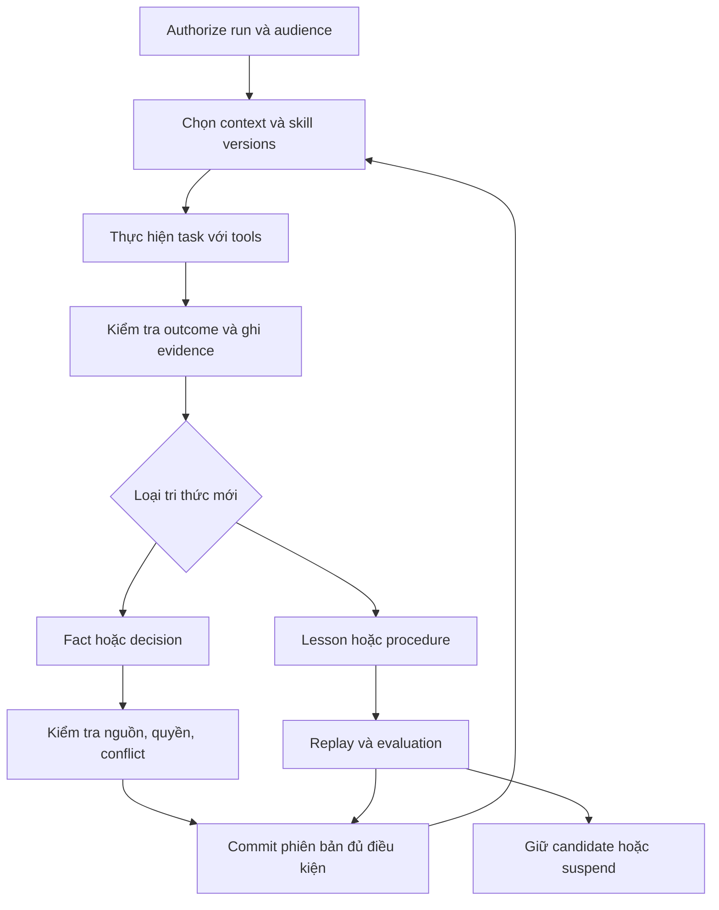

# MMA — Company Agent, Projects và vòng lặp học có kiểm chứng

**Date:** 2026-11-08 (Asia/Saigon)

**Spec repository:** `ba0f3/mattermost`, baseline `f1709e81d42a3f316435341d0380cd9336d83567`.

**Runtime repository:** `r2d-ai/mattermost-plugin-agents`, source examined at `edfc6e15319932c32c5d03fabda8867618facfcc`.

**Status:** Design specification để review và tách implementation plans. Tài liệu này định nghĩa hành vi cần xây dựng; không tuyên bố các capability mới đã được triển khai hoặc kiểm thử trên production.

**Decision basis:** Các yêu cầu đã thống nhất trong trao đổi ngày 2026-11-08. Các giá trị vận hành và lựa chọn kỹ thuật ghi là **mặc định thiết kế** là đề xuất của spec, không phải số đo production. Ví dụ game, số liệu và tình huống bên dưới chỉ là dữ liệu minh họa.

**Principle:** Go-first, mở rộng Mattermost Agents theo module trong plugin; dùng PostgreSQL và storage hiện có; phân quyền trong code; tự động ghi nhận tri thức; có bằng chứng trước khi kích hoạt kinh nghiệm thành cách làm mới.

## 1. Mục tiêu và quyết định kiến trúc

MMA trở thành assistant chung của công ty: sử dụng lại tri thức đã có, tự ghi nhận quyết định và kết quả nghiên cứu, tổng hợp kiến thức có giá trị, học từ kết quả thực hiện để làm tốt hơn ở những lần sau. Người dùng không phải quản lý từng mẩu memory hoặc duyệt từng bản tóm tắt.

Các yêu cầu bắt buộc:

| ID | Quyết định |
|---|---|
| R01 | Chỉ có một concept **Project**. Không bổ sung Collection làm đơn vị tổ chức/chia sẻ song song. |
| R02 | Mỗi Project có owner quản lý, description, instructions, nhiều threads, tài liệu, artifacts và KB/memory. |
| R03 | Owner chia sẻ Project cho user hoặc channel với Read/Write. Quyền Write không bao gồm quản lý chia sẻ. |
| R04 | Chia sẻ Project chia sẻ tri thức và tài nguyên đủ điều kiện; không chia sẻ transcript, danh sách thread hoặc tiêu đề thread riêng của người khác. |
| R05 | Agent tự lưu quyết định, sự kiện và tri thức công việc đủ điều kiện. Không có bước bắt buộc chọn từng fact để lưu hoặc duyệt trước khi share. |
| R06 | Quyền sử dụng KB trong channel đến từ grant cho **đúng channel**, không đến từ quyền cá nhân của người hỏi. |
| R07 | Tất cả dữ liệu là tài sản công ty. Xóa của user là soft delete; dữ liệu bị xóa không được phục vụ cho user/model bình thường nhưng vẫn có thể được cấp giám sát hợp lệ truy xuất. |
| R08 | Chỉ admin có quyền purge riêng mới được quyết định xóa vật lý dữ liệu rác, với phạm vi cụ thể và audit. |
| R09 | Self-learning phải có vòng khép kín: thực hiện → kiểm chứng → rút kinh nghiệm → kiểm tra → phiên bản mới → tái sử dụng → đo kết quả. |
| R10 | Subagents và tác vụ dài có trạng thái bền vững, giới hạn chi phí, hủy được, và không mở rộng quyền của run gốc. |
| R11 | Telegram là adapter vào cùng runtime. GoClaw là nguồn migration và tham khảo cơ chế; đích vận hành là một runtime MMA. |
| R12 | Có giao diện browse/search tài liệu, hình ảnh, artifacts, tri thức và các phiên bản được phép thấy. |

“Tự học” trong spec là thay đổi tri thức và quy trình được truy hồi trong các run sau. Fine-tune trọng số model, tự sửa code production, tự sửa ACL hoặc tự thay đổi chính sách bảo mật không nằm trong phạm vi này.

### 1.1. Các tình huống phải hỗ trợ

- HR/IT hỏi quy định công ty, có nguồn và ngày hiệu lực.
- Tech và Game Operations hỏi tính năng, công thức, cách tính chỉ số từ code/config; không cần đọc code để hiểu câu trả lời.
- Game Operations yêu cầu phân tích economy, lực chiến, event; agent lấy dữ liệu được phép, kiểm tra tính toán và đưa đề xuất cùng giả định.
- BD nghiên cứu thị trường; kết quả được lưu trong Project để người khác có quyền sử dụng lại.
- Writer chốt “Project dùng Godot”; người được share hỏi ở thread riêng khác và nhận đúng quyết định hiện hành.
- Một lỗi phân tích đã được xác minh tạo ra kinh nghiệm; những lần phân tích tương tự sau dùng kinh nghiệm đó và giảm lỗi đo được.

### 1.2. Những kết quả không được xem là hoàn thành

- Chỉ index thêm file nhưng không giải quyết Project, ACL và memory tự cập nhật.
- Chỉ tóm tắt lịch sử định kỳ rồi gọi đó là learning.
- Chỉ tăng số lượng memory/skill hoặc lượt recall mà không đo chất lượng công việc.
- Dùng lời nhắc “không tiết lộ” thay cho authorization trước khi đưa dữ liệu vào model.
- Buộc người dùng duyệt từng fact, hoặc phải tiếp tục vận hành GoClaw để có một phần chức năng chính.

## 2. Hiện trạng đã kiểm tra và phương án lựa chọn

### 2.1. Các phần có thể tái sử dụng

MMA đã có các điểm vào DM/channel/Agents pane, MCP, web search, semantic search, file/artifact handling, tool policies và telemetry theo README cùng hướng dẫn repo [S1]. `resolveTurnPolicy` tập trung việc xác định quyền và hành vi của turn; nó là điểm tích hợp cho execution context mới [S2]. `wakeup.go` có scheduling và khóa resume theo conversation; đây là cơ chế cần tái sử dụng hoặc tích hợp, không phải bằng chứng đã có một durable learning engine [S3]. Index pass đã có checkpoint theo prefix đã xử lý và lưu idempotent; có thể học lại nguyên tắc này cho ingestion/learning [S4].

Việc đọc một file trong một turn không đồng nghĩa file đó đã trở thành tài liệu KB có extraction, version, ACL, reindex và lifecycle đầy đủ. Trước implementation phải lập inventory các đường đọc/ghi/index hiện có; không suy ra “mọi upload đã index” từ capability đọc attachment. Spec không thay thế một cuộc audit runtime đầy đủ.

### 2.2. Phương án đã cân nhắc

| Phương án | Lợi ích | Đánh đổi | Quyết định |
|---|---|---|---|
| Giữ MMA làm UI, chuyển tác vụ sang GoClaw | Có thể dùng nhanh một số cơ chế hiện có | Hai runtime, hai nơi lưu memory, hai lớp ACL và vận hành | Không chọn làm kiến trúc đích. Chỉ cho phép adapter migration có thời hạn. |
| Bổ sung RAG/file search và summary cron vào MMA | Phạm vi ban đầu nhỏ | Không giải quyết học quy trình, bằng chứng chất lượng và vòng đời tri thức | Chỉ là một phần của nền tảng. |
| MMA sở hữu Project, KB, execution và learning | Một mô hình quyền, một nơi quản lý dữ liệu và chạy agent | Phải xây các primitive còn thiếu và chứng minh bằng eval | **Phương án chọn**, phù hợp mục tiêu đã chốt. |

Hermes có background review cho memory/skills và curated procedural knowledge; đây là mẫu tham khảo về biến trải nghiệm thành tài nguyên tái sử dụng [S5], [S6]. GoClaw có cả dreaming và cơ chế evolution riêng [S7], [S8]. Không kết luận rằng việc có các cơ chế này tự chứng minh cải thiện chất lượng trên tác vụ của công ty.

Tại snapshot GoClaw đã đọc, dreaming ghi kết quả vào đường dẫn theo ngày và `PutDocument` upsert nội dung theo đường dẫn; một batch sau có thể thay nội dung consolidation trước đó nếu dùng cùng key [S7], [S9]. Spec chọn các item/version riêng và lineage thay vì một file summary theo ngày làm nguồn tri thức chuẩn. Đây là quan sát source, chưa phải kết luận về nguyên nhân hiệu quả production của GoClaw.

## 3. Mô hình Project và trải nghiệm người dùng

### 3.1. Các đối tượng nhìn thấy trong UI

| Thành phần | Nội dung | Phạm vi mặc định |
|---|---|---|
| Project | Tên, description, instructions, owner, sharing | Project ACL |
| Threads của tôi | Các cuộc hội thoại trong Project; có thể đổi tên và chuyển vào Project | Chủ thread; không liệt kê thread người khác |
| Knowledge | Quyết định, facts, tài liệu tổng hợp, assumptions, conflicts | Phần Project KB đủ điều kiện |
| Files & Artifacts | Tài liệu, bảng tính, hình ảnh, báo cáo, file do agent tạo | Project hoặc private scope ghi trên từng đối tượng |
| Activity | Những thay đổi tri thức/tài nguyên được phép thấy | Không chứa excerpt hoặc metadata thread riêng của người khác |
| Sharing | User/channel và Read/Write | Owner; không phải quyền Write thông thường |

Project không có “shared chat history” trong MVP. Description và instructions là phần chia sẻ; private preferences hoặc personal memory không được đưa vào đây tự động. Instructions được version và là cấu hình của Project, không phải lớp security policy.

Read/Write được thể hiện bằng nhãn dễ hiểu. Người có Read vẫn mở thread riêng để hỏi bằng KB đã share. Nếu họ nói một quyết định mới, agent giải thích quyền Write cần thiết để cập nhật tri thức chung; không tạo hàng đợi buộc owner duyệt phát biểu của reader.

### 3.2. Cam kết privacy đối với thread

Trong Project có sharing, UI thông báo một lần và hiển thị trạng thái ổn định:

> Hội thoại này chỉ bạn xem được. Các quyết định và kiến thức công việc đủ điều kiện có thể tự cập nhật vào Knowledge của Project nếu bạn có quyền Write.

“Thread riêng” bảo vệ transcript và nội dung không đủ điều kiện chia sẻ. Nó không hứa rằng mọi thông tin công việc được nói trong thread sẽ bí mật đối với Project. Người muốn giữ nội dung trong phạm vi riêng sử dụng chat riêng ngoài Project hoặc private attachment được đánh dấu rõ; không cần chọn lưu từng fact trong luồng làm việc bình thường.

Owner Project không có quyền xem thread riêng của cộng tác viên. Company supervision là một capability riêng, không được bật ngầm khi owner mở Project.

### 3.3. Tạo, chuyển và chia sẻ Project

- Project mới chưa có grant ngoài owner. Mọi dữ liệu vẫn thuộc công ty.
- Share thêm user/channel áp dụng cho KB/tài nguyên đang active trong phạm vi chia sẻ đó, bao gồm kiến thức được tự lưu trước thời điểm share. Không mở transcript.
- Chuyển thread vào Project không chia sẻ transcript. Với Writer, các nguồn đủ điều kiện trong thread được đưa vào backfill theo cùng chính sách automatic memory; nguồn restricted giữ nguyên ràng buộc. Với Reader, thread chỉ được tổ chức lại và dùng để hỏi; không ghi vào KB chung.
- Chuyển thread ra khỏi Project dừng đóng góp mới. Các đóng góp cũ vẫn gắn với Project ban đầu cho đến khi bị sửa, thu hồi hoặc soft delete; thao tác move không tự sao chép chúng sang Project mới.
- File upload vào **Files của Project** cần Write. Attachment trong thread có phạm vi được UI ghi rõ: shared Project hoặc private to thread. Với Reader, upload chỉ thuộc private thread.
- Báo cáo/artifact sinh từ nguồn Project và run có Write được lưu vào Project khi đủ điều kiện xuất bản; output của Reader ở private thread vẫn thuộc private scope.
- Share Project tới channel cấp quyền sử dụng trong chính channel đó. Thành viên mở trang tài nguyên từ channel với cùng channel scope; grant này không tự tạo grant cá nhân cho DM hoặc Project thread riêng.

Đây là mặc định thiết kế để không biến quyền theo channel thành quyền cá nhân ngầm. Muốn dùng Project trong thread riêng, owner có thể share trực tiếp cho user; không cần grant cá nhân bổ sung để agent sử dụng trong channel đã được share.

## 4. Authorization: một policy dùng cho mọi đường truy cập

### 4.1. Vai trò và capability

| Hành động | Reader | Writer | Owner | Company supervisor | Purge admin |
|---|---|---|---|---|---|
| Đọc KB/file đủ scope | Có | Có | Có | Theo phạm vi giám sát | Không tự có quyền đọc qua vai trò purge |
| Tạo thread riêng, hỏi agent | Có | Có | Có | Theo quyền bình thường hoặc chế độ giám sát riêng | Theo quyền bình thường |
| Đóng góp/sửa KB, file, Project instructions | Không | Có | Có | Không ngầm sửa qua quyền giám sát | Không ngầm sửa |
| Soft delete nội dung chung | Không | Có | Có | Capability quản trị riêng nếu được cấp | Capability riêng nếu được cấp |
| Đổi tên/description Project | Không | Có | Có | Không ngầm sửa | Không ngầm sửa |
| Share/revoke, xóa Project, chuyển owner thông thường | Không | Không | Có | Chỉ qua quy trình quản trị được ủy quyền | Không ngầm có quyền share |
| Xem transcript của người khác/dữ liệu đã soft delete | Không | Không | Không | Có, đúng scope và có audit | Chỉ khi cũng có scope giám sát cần thiết |
| Xóa vật lý dữ liệu rác | Không | Không | Không | Không mặc định | Có, với quyền purge và phạm vi dữ liệu tương ứng |

User luôn quản lý/soft delete thread riêng của mình. Writer có thể sửa tri thức chung nên mọi thay đổi có version và actor; không dùng một hàng đợi phê duyệt để thay cho quyền Write.

### 4.2. Execution context bắt buộc

Server tạo `ExecutionContext` trước retrieval hoặc gọi model, gồm tối thiểu:

- Company/tenant ID; actor ID; agent ID; run ID và parent run ID nếu có.
- Surface: private, Mattermost channel, Telegram chat, background hoặc supervision.
- Channel/chat ID chính xác khi có; thread ID; Project IDs được chọn.
- Các capability hiệu lực: read, contribute, manage grants, supervision, purge; tool policy và credential binding.
- Audience/output target; source constraints; policy/ACL epoch; mức phân loại dữ liệu.
- Budget, deadline, cancellation state; phiên bản policy, instructions và skills.

Context này do server kiểm chứng, không nhận quyền trực tiếp từ tool arguments hoặc nội dung model. Store/service/tool API bắt buộc nhận context hoặc capability đã xác thực. Service account của worker không tự trở thành chủ thể đọc tất cả dữ liệu công ty.

Quyền hiệu lực:

| Surface | Nguồn cấp quyền Project | Điều kiện bổ sung |
|---|---|---|
| Private Project thread | Owner hoặc grant trực tiếp cho user | Thread thuộc user, agent được phép dùng, nguồn còn active |
| Mattermost channel | Grant cho đúng `channel_id` | Requester là thành viên hợp lệ, agent được dùng trong channel, tool policy cho phép |
| Telegram group | Grant cho đúng external chat đã xác minh | Identity/membership và channel policy đã xác thực; không dùng quyền DM của người hỏi |
| Background/subagent | Delegation của context gốc hoặc contribution job được scope rõ | Không union thêm quyền của actor/service account; recheck trước mọi lần sử dụng |
| Supervision | Capability giám sát với scope và mục đích rõ | Đường truy cập riêng, có audit; không mang dữ liệu sang run bình thường |

Channel Read giới hạn toàn bộ run ở Read kể cả người hỏi là Owner cá nhân. Channel Write cho phép các thành viên hợp lệ đóng góp trong channel mà không cần user grant trùng lặp. Không có channel grant thì deny, kể cả tất cả thành viên đều có user grant.

### 4.3. Những nơi phải thực thi cùng policy

Authorization được áp dụng **trước khi nội dung** đi vào model, reranker, embedding service có xử lý truy vấn/tài liệu theo người dùng, hoặc tool. Retrieval lọc tenant, Project, source restrictions, revision và deletion state tại tầng query; không chỉ lọc kết quả cuối.

Các đường bắt buộc bao phủ: search/list/count/autocomplete; source preview; download/thumbnail/OCR; HTML artifact; citations; exports; WebSocket events; API trực tiếp; MCP; background jobs; subagents; replay/regenerate; tool approval/ask-user resume; scheduled runs; bridge calls; debug/support tools.

Cache key phải bao gồm scope, audience và policy version phù hợp; cache hit không bỏ qua live authorization. Không dùng một semantic answer cache chung cho các principal khác quyền. URL tải file không trở thành bearer link tồn tại lâu và bỏ qua revoke; tải qua endpoint kiểm tra quyền hoặc credential có khả năng thu hồi tương đương.

Revoke tăng ACL epoch và hủy/đánh dấu stale các run, cache, delegated capability liên quan. Kiểm tra lại trước đọc nguồn, trước tool side effect, trước commit shared state và trước mỗi lần phát nội dung protected. Nếu kết quả tool quay về sau revoke thì không đưa kết quả đó vào model/output. Đối với stream, dừng các chunk chưa phát; không thể thu hồi nội dung người dùng đã đọc trước thời điểm revoke.

## 5. Chia sẻ knowledge mà không làm lộ nguồn riêng

### 5.1. Phân biệt quyền đọc nguồn và quyền xuất bản tri thức

Mỗi nguồn có `origin_scope`, nguồn gốc, revision và chính sách audience. Đọc được nguồn không đồng nghĩa được publish dữ liệu từ nguồn sang audience rộng hơn.

| Nguồn | Xử lý tự động |
|---|---|
| Phát biểu công việc của Writer trong Project thread đủ điều kiện | Có thể tạo Project knowledge theo chính sách đóng góp đã công bố; transcript vẫn riêng |
| Project document/artifact được upload/shared hợp lệ | Có thể index, tổng hợp và đóng góp trong cùng audience hợp lệ |
| Phát biểu của Reader | Chỉ private conversation state; không đổi KB/instructions/skills chung |
| Private attachment, personal memory, Project khác, MCP trả dữ liệu restricted | Giữ source constraints; không tự biến thành Project knowledge rộng hơn |
| Web/public source | Có thể lưu research với URL, thời điểm, độ tin cậy và quyền lưu phù hợp; nội dung trang không có quyền ra lệnh cho agent |
| Quote/example/assistant suggestion | Lưu đúng loại khi có ích; không tự thành quyết định của người có thẩm quyền |

Policy cho phép trích xuất tri thức công việc từ eligible Project thread là một phép biến đổi được ủy quyền cụ thể. Nó không cấp quyền declassify mọi dữ liệu tình cờ xuất hiện trong context.

### 5.2. Lineage và audience của dữ liệu suy ra

Đối với output phụ thuộc tài liệu/tool restricted, audience phải thỏa tất cả hạn chế nguồn còn áp dụng, đồng thời không rộng hơn target Project/run. Server theo dõi nguồn thực tế đã đưa vào run. Nếu chưa tách được dependency tới từng claim, toàn bộ output kế thừa tập hạn chế bảo thủ của các nguồn đã đọc; không nhờ LLM tự khai rằng nó “không dùng” nguồn riêng.

Background job xuất bản vào Project chỉ được đọc partition nguồn đủ điều kiện cho Project đó. Không gom toàn bộ personal memory rồi yêu cầu model lọc thông tin nhạy cảm. Nguồn có audience hẹp hơn ở partition riêng; không tự tạo một nested collection trong UI để che vấn đề ACL.

Không dùng text classifier như một ranh giới phân quyền. Classifier có thể giúp nhận diện dữ liệu nhạy cảm, quotation hoặc candidate không rõ, nhưng source scope và write capability mới quyết định đường xuất bản. Với thông tin user tự gõ mà hệ thống không biết nguồn ngoài, cam kết privacy tuân theo contribution policy hiển thị ở Project; hệ thống không thể suy ra chắc chắn quyền của một nguồn không được khai báo.

### 5.3. Provenance an toàn cho người đọc

Lưu hai biểu diễn:

1. **Internal provenance:** source IDs/revisions, message offsets hoặc page/cell/code location, extraction version, actor, run và validation evidence. Quyền đọc provenance không tự cấp quyền đọc raw source.
2. **Audience-safe evidence:** nội dung tri thức đã xuất bản hợp lệ, trạng thái, thời điểm hiệu lực/cập nhật và nguồn có thể hiển thị. Không lộ thread ID/URL, tiêu đề thread, đoạn chat lân cận hoặc tên tài liệu restricted.

Người được share có thể đọc “Project dùng Godot; quyết định hiện hành, cập nhật ngày …” mà không cần quyền đọc transcript gốc. Citation dẫn tới Knowledge item họ được phép xem. Chỉ principal có quyền raw source mới có link mở nguồn gốc. Shared summary không phải một đường truy cập gián tiếp tới private transcript.

## 6. Data model và quyền sở hữu dữ liệu

Đây là logical schema; tên SQL cụ thể theo convention của plugin khi viết implementation plan. Mọi ID được lưu bằng ID ổn định, không dùng tên làm khóa [S15].

| Entity | Trường và quan hệ thiết yếu |
|---|---|
| Project | Company, owner, title, description, instructions version, status, ACL epoch, deletion metadata |
| ProjectGrant | Project, principal type `user/channel/external_chat`, principal ID, Read/Write, grant/revoke actor/time |
| ProjectThread | Project, conversation/thread ID, user owner, contribution eligibility, move history; danh sách riêng theo user |
| Source / SourceRevision | Kind, origin scope, source ID, immutable revision/hash, content object refs, source constraints, authored/observed/ingested time, lifecycle |
| ContributionAdmission | Source ID/revision/hash, Project, actor/surface, audience/constraints, extraction policy, ACL epoch và thời điểm được chấp nhận; không cấp quyền cho revision tương lai |
| KnowledgeItem / KnowledgeVersion | Kind, semantic key, structured value/body, status, effective scope/time, evidence refs, supersedes/conflict links, validation state |
| Artifact / ArtifactVersion | File/object refs, MIME, title, producing run, dependencies, audience, preview status, deletion metadata |
| Episode | Goal, execution recipe, tool outcomes, outcome verification, failure/recovery, evidence refs; không phải bản dump transcript |
| Procedure / ProcedureVersion | Applicability, prerequisites, steps, tool contracts, verifier, expected outputs, limits, source episodes, evaluation record |
| Run / RunStep / Delegation | Context, parent, selected versions, states, checkpoints, action intents/results, usage, cancellation |
| Job / OutboxEvent | Source event/revision, partition, idempotency key, lease, attempts, checkpoint, terminal reason |
| Evaluation / Case | Dataset/version, sealed cases, evaluator version, baseline/candidate, outcomes, cost, safety regression results |
| AuditEvent / PurgeManifest | Actor, action, object IDs, outcome, reason code, timestamp, trace; không chứa nội dung nhạy cảm |

Source records và business knowledge là dữ liệu chuẩn. Embeddings, search chunks, materialized summaries và cache là projections có thể tái tạo, không được làm bản lưu duy nhất của tri thức công ty.

### 6.1. Lifecycle

- Source: active → soft_deleted → restored hoặc purged theo quyền riêng.
- Knowledge: candidate → active → stale / superseded / conflicted / withdrawn / soft_deleted. Sửa đổi tạo version mới; không blind overwrite.
- Procedure: candidate → validating → active → suspended / superseded / archived. Không dùng một procedure chưa được validate như hướng dẫn bắt buộc.
- Run: queued → running → waiting / completed / failed / canceled / expired. Expired kết thúc quyền thực thi, không xóa hồ sơ nghiệp vụ.

Không đưa “độ tin cậy của model” vào cùng một field với quyền, trạng thái quyết định hay chất lượng eval. Recall count là tín hiệu hữu ích để xếp hạng sử dụng, không là bằng chứng sự thật.

### 6.2. Company ownership, supervision, offboarding

Owner là người quản lý hoạt động và sharing của Project, không là chủ sở hữu pháp lý riêng của dữ liệu. Offboarding khóa user sessions/capabilities và hủy công việc còn chạy dưới danh tính đó. Project, grants của người khác, nguồn và lịch sử vẫn tồn tại; người quản trị được ủy quyền có thể chuyển owner hoặc đặt custodian với audit.

Mặc định, grant của cộng tác viên còn hiệu lực khi owner nghỉ việc; grant của user nghỉ việc bị revoke. Không trao quyền manage grants tự động cho Writer. Supervision được scope theo công ty/đơn vị/Project và mục đích; hành vi inspect/export/recover có audit riêng. Quyền admin hạ tầng không tự trở thành quyền giám sát trong API của ứng dụng.

### 6.3. Soft delete và purge

Soft delete phải ngăn mọi lần phục vụ mới qua UI/API, retrieval, model context, citation, cache, export và resumed run. Tombstone và deny fence có hiệu lực ngay; xóa projection khỏi index chạy bất đồng bộ sau đó. Xóa source làm withdrawn các tri thức chỉ được hỗ trợ bởi source đó. Nếu còn nguồn độc lập hợp lệ, recompute từ nguồn còn lại; summary của chính source bị xóa không được tính là “nguồn độc lập”.

Soft delete thread giữ nguyên hồ sơ cho supervision nhưng loại nội dung và dependency độc nhất của nó khỏi phục vụ bình thường. Revoke một user không xóa các đóng góp hợp lệ đã được commit trước đó; đó vẫn là tài sản Project. Restore phải kiểm tra lại original scope, grants hiện tại, dependency và index state; không tự khôi phục grant đã revoke.

Retention phải bao phủ original file, revisions, transcripts, structured memories, artifacts và evidence. Cần tích hợp với Mattermost retention/file cleanup/offboarding để các cơ chế cũ không xóa vật lý bản chuẩn trước chính sách mới. Nếu plugin hook không giữ được record đúng lifecycle, implementation phải bổ sung integration nhỏ ở server hoặc kho lưu nguồn được quản lý trước khi bật ingestion; không tuyên bố retention đầy đủ chỉ vì bảng KB còn tồn tại.

Purge yêu cầu một manifest immutable: danh sách object/version/dependency, lý do là dữ liệu rác, actor và phạm vi được duyệt. Chỉ purge admin có scope tương ứng được thực thi. Xử lý cả blobs, derived indexes, replicas và các lần backup restore theo chính sách đã cấu hình; backup không được làm dữ liệu đã purge sống lại. Nếu backup không hỗ trợ xóa từng object, manifest tombstone phải được replay trước khi restore được phục vụ; ghi rõ thời hạn loại khỏi backup. Không tuyên bố đã xóa mọi bản sao khi chưa có bằng chứng.

TTL/GC được phép dọn cache hoặc index tái tạo, không tự purge business records. Archival của learning là thay đổi trạng thái hoặc soft delete, không phải xóa vật lý.

## 7. Ingestion, search và dữ liệu hiện hành

### 7.1. Pipeline thống nhất

Mọi upload, connector hoặc import đi qua: nhận nguồn và scope → lưu revision gốc → kiểm tra/extract → tạo cấu trúc/chunks → index → tạo knowledge candidates → validation/publish theo policy. Mỗi bước có trạng thái, lỗi quan sát được và retry; không đánh dấu hoàn thành khi chỉ mới ghi vector.

| Nguồn | Yêu cầu extraction |
|---|---|
| DOCX / Markdown / HTML | Giữ heading, bảng, metadata và source offsets; HTML sanitize, không thực thi script |
| PDF | Text extraction và OCR nếu cần; giữ page, extraction confidence; chỉ rõ khi không đọc được |
| XLSX | Giữ sheet, cell/range, công thức và cached/evaluated value; không chạy macro; phân biệt giá trị không được recalculation |
| Hình ảnh | Original, thumbnail, OCR/caption nếu model hỗ trợ; provenance và uncertainty của nhận dạng |
| Repo/code/config | Repo/ref/commit, file/symbol/range; deployment/environment mapping riêng; cập nhật theo revision |
| Market/web research | URL, publisher, ngày xuất bản nếu có, fetched time, citations và scope của bản nghiên cứu |
| Chat | Message revision, tác giả/quyền đóng góp, thread privacy, source dependencies; event mới/sửa/xóa |

Parser chạy với giới hạn tài nguyên, network/tool capabilities tối thiểu, file size/type controls và xử lý file lỗi/zip bomb/macro. Embedded instruction không được chạy như tool command. Tài liệu không parse được vẫn xuất hiện với trạng thái lỗi hợp lệ để user biết, không bị im lặng bỏ qua.

### 7.2. Retrieval contract

Truy hồi theo lớp: quyết định/fact hiện hành từ structured store → tìm keyword/vector trên nguồn đúng scope → rerank phần đã authorize → hydrate source revisions → kiểm tra citation. Giới hạn context theo task; chỉ mở rộng phần liên quan. Truy vấn chính xác tên quyết định hoặc công thức không phụ thuộc hoàn toàn vào similarity của embedding.

Structured commit mới phải được đọc được trước khi vector index bắt kịp. Kết quả trả về có status, nguồn, effective/observed time và version. Mặc định không đưa candidate, stale, superseded hoặc conflicted item vào câu trả lời như một fact đã chốt; conflict phải được nêu rõ. Historical/as-of queries có thể đọc phiên bản được phép với trạng thái và thời điểm được ghi rõ.

### 7.3. Code, công thức và “chỉ số hiện tại”

Index code cho biết implementation tại commit cụ thể. Nó không chứng minh config hoặc hành vi đang chạy ở production. Agent phải phân biệt: công thức theo source, giá trị config theo deployment snapshot, và metric quan sát qua tool ở thời điểm nào.

Metric hiện tại cần read-only connector có scope, environment, query definition, observation time, unit và freshness requirement. Khi connector lỗi hoặc snapshot quá hạn, câu trả lời phải ghi rõ thời điểm dữ liệu gần nhất; không gọi một giá trị nằm trong embedding là “hiện tại”. Các kết luận cân bằng game phải nêu phiên bản công thức, tham số, cohort/time range, giả định và cách tái tính.

## 8. Memory tự động: ghi nhận nhanh và tổng hợp nền

### 8.1. Bốn loại tài sản học được

| Loại | Ví dụ | Cách sử dụng |
|---|---|---|
| Fact / Decision | Engine hiện hành là Godot; ngày áp dụng một chính sách | Trả lời nhất quán và cập nhật trạng thái công việc |
| Domain knowledge / Research | Giải thích công thức lực chiến; nghiên cứu thị trường có dẫn nguồn | Hiểu nghiệp vụ và tái sử dụng nghiên cứu |
| Episode / Lesson candidate | Lần phân tích dùng nhầm staging config và cách phát hiện | Chứng cứ để học, chưa tự thành quy tắc |
| Procedure / Skill | Trước phân tích economy phải xác minh deployment/config và tái tính các chỉ số | Hướng dẫn thực thi có điều kiện áp dụng và verifier |

Không biến tất cả lịch sử thành một summary chung. Tóm tắt là một projection phục vụ context; từng quyết định, fact và procedure có định danh/version riêng.

### 8.2. Fast path cho quyết định rõ

Khi Writer nói “chốt Project này dùng Godot”, agent tạo một structured contribution trong turn đó. Server kiểm tra actor/surface Write, Project, source eligibility, sự phù hợp schema và phiên bản đang active, rồi commit source event và decision/version cùng outbox trong transaction.

Agent chỉ nói **“đã ghi nhớ”** sau khi commit thành công. Nếu bước ghi lỗi, vẫn giữ message/source theo retention và hiển thị trạng thái chưa cập nhật; không báo đã nhớ. Nếu extraction chưa xác định được đó là quyết định hay ví dụ, lưu candidate và không đổi fact đang active. Không yêu cầu user xác nhận mỗi quyết định rõ.

Sau commit, một user khác có Read hỏi ngay trong thread khác phải nhận Godot từ structured read path, dù embedding/consolidation chưa chạy. Khả năng này phải sống sót sau process crash.

### 8.3. Job nền cho nội dung mới và thay đổi

Outbox nhận sự kiện message/file/artifact create, edit, delete, source refresh, user correction, run outcome và ACL change. Worker xử lý phần chưa có extraction hoặc đã đổi revision; không chỉ dựa vào compaction count, ngày hoặc thời điểm process khởi động.

Mặc định thiết kế: debounce 30 giây cho các sửa đổi liên tiếp, gom batch theo Project và source constraint; reconcile sweep mỗi 15 phút để sửa outbox/checkpoint bị gián đoạn. Sweep không gọi LLM khi không có delta hoặc lý do revalidation.

Khi source revision thay đổi, hệ thống phải đánh dấu các dependency bị ảnh hưởng là stale trước lần phục vụ tiếp theo bằng live revision/dependency fence; không chờ extraction hoặc vector reindex. Nếu chưa xác định được dependency tới từng claim, áp dụng stale bảo thủ cho các item phụ thuộc revision đó. Item stale không được trình bày như fact hiện hành hoặc inject như procedure active. Historical/as-of access vẫn được phép trong scope hợp lệ với version và trạng thái được ghi rõ. Reconciliation xác nhận lại hoặc tạo version mới trước khi phục hồi trạng thái active.

Job được xử lý ít nhất một lần; commit có hiệu ứng idempotent. Key gồm company, Project, source ID/revision, extraction policy version và job kind. Checkpoint chỉ vượt qua prefix đã commit hoặc trạng thái terminal có lý do; retry không làm tăng confidence hoặc tạo nhiều facts cho cùng evidence.

### 8.4. Quy tắc cập nhật nội dung

- Decision chỉ đến từ phát biểu được xác định là quyết định của principal có quyền đóng góp; quotation, phủ định, role-play và assistant suggestion không tự có thẩm quyền.
- Nói “đổi từ Unity sang Godot” trong đúng scope tạo supersession rõ ràng. Hai Writer đưa quyết định trái nhau nhưng không chỉ rõ thay thế thì giữ conflict; không dùng timestamp cuối hoặc embedding score làm người phân xử.
- Mặc định, Writer có thể thay quyết định trong phạm vi Project bằng một correction/supersession rõ. Domain muốn phân quyền quyết định chi tiết hơn có thể thêm capability nghiệp vụ sau; không tạo role mới cho MVP.
- User correction và bằng chứng mới có thể làm suspended một procedure đã active. Giữ version cũ cho audit, không tiếp tục inject vào run mới.
- Kết luận do agent suy ra phải mang loại inference/hypothesis, nguồn và điều kiện áp dụng; không nâng thành “user đã chốt”.
- Một ý được lặp lại qua nhiều summary cùng nguồn vẫn chỉ có một nguồn chứng cứ. Không tạo vòng tự củng cố bằng cách trích dẫn lại output của chính agent.

### 8.5. Quyền của background learning

Phân biệt hai loại job. **Continuation của user run** luôn kế thừa context gốc và bị thu hẹp/cancel khi quyền gốc bị revoke. **Project contribution job** xử lý source event đã được chấp nhận hợp lệ vào Project bằng service capability chỉ cho Project/partition đó; không impersonate user hoặc đọc thêm nguồn cá nhân.

Một contribution được chấp nhận là một `ContributionAdmission` bất biến, bind với đúng Project, source ID/revision/hash, source constraints, audience và extraction policy. Server kiểm tra quyền contribute hiệu lực của actor/surface tại thời điểm chấp nhận và ghi admission cùng source snapshot/outbox bằng transaction có authorization fence tương đương. Nếu source nằm trong giao dịch hệ thống khác, admission chỉ hoàn tất sau khi lưu được đúng revision và kiểm tra live ACL; việc ingest hay enqueue trước đó không thay thế bước này.

Việc thread thuộc Project hoặc partition có admission cũ không cấp quyền cho revision tương lai, attachment chưa được authorize hoặc mọi nội dung có thể phát sinh trong partition. Worker luôn recheck lifecycle, source/dependency revision, audience và policy hiện tại trước khi đọc/commit/publish.

Khi Writer mất quyền, những đóng góp đã commit vẫn thuộc Project. Một job đã có source contribution hợp lệ chỉ được hoàn tất trên phần source đã chấp nhận, còn active và policy hiện tại cho phép. Nó không được dùng token của user cũ để đọc thêm, lấy attachment private, tiếp tục tool action, hoặc mở rộng audience. Nếu chưa có contribution được chấp nhận trước revoke thì job không được tạo mới shared contribution dựa vào snapshot quyền cũ.

## 9. Agent loop và harness engineering

Các nguồn tham khảo hướng tới context có cấu trúc, kiểm tra outcome, feedback có thể tái sử dụng và đánh giá cùng cấu hình; chúng không cung cấp sẵn một harness phù hợp với dữ liệu/ACL của công ty [S10], [S11], [S12], [S13], [S14]. MMA áp dụng các nguyên tắc đó bằng contract dưới đây.

### 9.1. Context assembly

Context builder dùng execution scope, mục tiêu task và độ mới để chọn: Project instructions → quyết định liên quan → facts/doc fragments → procedure phù hợp → trạng thái run. Danh mục skills chỉ chứa mô tả ngắn và điều kiện áp dụng; mở full instructions khi cần. Không nhồi mọi memory, toàn bộ tool catalog hoặc lịch sử công ty vào system prompt [S10].

Project instructions, retrieved documents và tool output có trust level khác security policy của server. Nội dung nguồn không được thay tool allowlist, credential binding, ACL, budgets hoặc evaluator configuration. Model có thể đề nghị một action; server quyết định action có hợp lệ.

### 9.2. Planning, execution và outcome verification

Task đơn giản dùng một loop ngắn. Task dài có kế hoạch, bước/checkpoint, deliverables và tiêu chí hoàn thành. Subagents chỉ được tạo khi phần việc tách được hoặc cần kiểm tra độc lập; không mặc định nhân agent cho mọi câu hỏi.

Tool execution ghi structured outcome: requested action, idempotency key, result reference, status, duration và external receipt nếu có. “Tool trả HTTP 200” hoặc “model nói xong” không tự chứng minh mục tiêu nghiệp vụ đạt.

Verifier được chọn theo task [S11], [S12]:

| Công việc | Bằng chứng hoàn thành |
|---|---|
| Hỏi quyết định/quy định | Fact active, nguồn đủ quyền, đúng effective date; không bỏ qua conflict |
| Tính toán/balance | Chạy lại phép tính có unit, config/ref và dữ liệu đầu vào; kiểm tra conservation/range theo domain |
| Báo cáo nghiên cứu | Các claim trọng yếu có nguồn đọc được, phân biệt fact/inference, kiểm tra độ phủ và mâu thuẫn |
| Tác vụ tool | Đối chiếu trạng thái đích/receipt với mục tiêu, không chỉ tool success flag |
| Procedure mới | Replay/eval trên trường hợp có ground truth và trường hợp chưa dùng để rút lesson |

Model-based grader có thể hỗ trợ chất lượng ngôn ngữ/nghiên cứu, nhưng cần rubric versioned và calibration với ví dụ đã đánh giá. Không dùng một lời tự nhận xét tích cực của cùng run làm gate duy nhất.

### 9.3. Learning sau mỗi run

Run kết thúc ghi outcome và evidence refs. Learning worker xem xét correction, failure/recovery, tool misselection, thiếu nguồn, cách tính sai và thành công có thể tái sử dụng. Không nhất thiết tạo memory từ mỗi run; “không có bài học mới” là kết quả hợp lệ.

Những nội dung chỉ có giá trị trong task hiện tại ở Episode. Candidate lesson phải nêu: tình huống áp dụng, vấn đề đã quan sát, điều kiện/gốc lỗi, cách sửa, chứng cứ, counterexample và điều kiện không dùng. Candidate procedure bổ sung prerequisites, tools, steps, expected outputs và verifier.

Learning là cập nhật có cấu trúc vào tập knowledge/skills, không viết lại một bản prompt dài sau mỗi lần ngủ. Cách tổ chức này sử dụng ý tưởng incremental context adaptation của ACE [S13], nhưng hiệu quả cho MMA phải được chứng minh bằng bộ tác vụ riêng.

## 10. Validation, tự cải thiện và consolidation

### 10.1. Gate theo loại thay đổi

| Thay đổi | Điều kiện kích hoạt tự động | Nếu chưa đạt |
|---|---|---|
| Quyết định rõ của Writer | Capability/scope hợp lệ; nguồn là phát biểu quyết định; schema, revision và conflict checks đạt | Giữ candidate hoặc báo chưa ghi thành công; không giả vờ đã nhớ |
| Fact/summary từ tài liệu | Nguồn active, đủ audience; claim gắn evidence; không bỏ mâu thuẫn quan trọng | Candidate và retry/review tự động theo ngân sách |
| Research insight | Evidence hiện hữu, phân biệt suy luận, kiểm tra tính toán và độ mới liên quan | Lưu hypothesis với giới hạn; không trình bày là fact |
| Procedure | Contract/tool validation; replay; regression/held-out eval; không mở rộng quyền; hiệu quả đạt gate ở dưới | Giữ candidate, không inject như skill active |
| Thay đổi harness code, system security, grant, purge policy hoặc tool privilege | Theo quy trình thay đổi phần mềm/chính sách hiện có của công ty | Agent không có API tự kích hoạt các thay đổi này |

Fact/decision không phải chờ bộ eval procedure mới được dùng. Các gate là kiểm tra của hệ thống; người dùng không phải duyệt từng memory hoặc từng summary.

Mặc định thiết kế cho procedure mới hoặc thay đổi hành vi đáng kể:

- Tập kiểm tra có ít nhất 10 scenario đại diện, trong đó ít nhất 3 case giữ kín khỏi tác vụ rút lesson; có failure và boundary cases liên quan. Chạy 3 trial/case cho baseline và candidate với cấu hình tương đương khi outcome có yếu tố ngẫu nhiên.
- Không có lỗi ACL, source laundering, retention, instruction injection hoặc side effect ngoài quyền trong bộ hard gates. Không có regression ở các scenario bắt buộc của task family.
- Candidate phải cải thiện outcome đã định nghĩa hoặc giảm chi phí/thời gian trong khi giữ outcome; chênh lệch và ngân sách được ghi trong Evaluation. Không đổi rubric sau khi nhìn kết quả để hợp thức hóa candidate.
- Nếu dữ liệu/ground truth chưa đủ, giữ candidate; có thể bổ sung case từ kết quả sau nhưng không gọi trạng thái đó là đã học hiệu quả.

Các ngưỡng trên là điểm bắt đầu cho pilot, không là chứng minh thống kê về mọi tình huống. Dataset, trial policy, significance/uncertainty reporting và outcome metric phải được version. So sánh baseline/candidate giữ nguyên model, tools, scope, task set và budget; khi đổi model phải đánh giá lại skill và các bước orchestration [S12], [S14].

Automatic activation giới hạn trong audience mà evidence và Project cho phép. Một procedure “có vẻ chung” nhưng học từ nguồn restricted không tự được đưa vào skill catalog toàn công ty. Catalog toàn công ty là tài nguyên có owner và grant riêng theo cùng concept Project; việc mở rộng sharing do chủ thể có quyền quyết định, không do agent tự gắn nhãn public.

### 10.2. Consolidation có mục đích

Job consolidation chạy khi có evidence mới, correction/conflict, source drift hoặc lịch bảo trì có delta. Nó có thể:

1. Hợp nhất các facts trùng với lineage giữ nguyên, không cộng điểm tin cậy cho bản sao.
2. Cập nhật decision register và knowledge overview của Project.
3. Phát hiện khoảng trống/mâu thuẫn và tạo câu hỏi hoặc research task có scope.
4. Tổng hợp những nghiên cứu liên quan thành tài liệu có nguồn, assumptions và thời điểm.
5. Tạo/đánh giá candidate procedure từ nhiều outcome phù hợp.
6. Đưa tri thức ít dùng/hết hiệu lực sang archived/superseded, giữ record theo retention.

Không có “dreaming toàn công ty” được phép đọc mọi dữ liệu rồi xuất bản về một kho chung. Mỗi partition có input audience và output target xác định. Một worker được quyền chạy nhiều partition vẫn phải mở context độc lập cho từng partition; không tái sử dụng prompt/KV cache chứa dữ liệu của partition trước.

Output phải là item changes hoặc artifact versions có expected head, không overwrite một file summary theo ngày. Một overview có thể được tái tạo, nhưng failure/retry không làm mất facts và versions đã commit trước đó. Mark job complete chỉ sau khi durable knowledge commit thành công; vector indexing có outbox riêng và trạng thái pending có thể quan sát.

### 10.3. Đo learning bằng ví dụ cụ thể

Ví dụ: agent phân tích economy từ config trong repo nhưng environment đang dùng override khác. Người dùng chỉ ra sai lệch; tool xác minh được release ID và effective config.

- **Fact mới:** config có hiệu lực của environment tại thời điểm quan sát, kèm deployment và timestamp.
- **Episode:** lần phân tích trước dùng sai nguồn; phép kiểm tra đã phát hiện và sửa như thế nào.
- **Procedure candidate:** trước khi phân tích, xác minh deployment và effective config; chỉ sau đó lấy metric cùng environment/time range và tái tính.
- **Validation:** case có override, không có override, config unavailable, user thiếu quyền và dữ liệu hết hạn; kiểm tra agent không lấy nhầm environment hoặc bịa số khi tool lỗi.
- **Lần sau:** run tương tự chọn procedure phù hợp; log version đã dùng, kiểm chứng số và so outcome/cost với baseline.

Chỉ sau bước cuối mới có bằng chứng learning đã giúp công việc. Việc lưu được một file “bài học kinh nghiệm” chỉ là đầu vào của vòng lặp.

## 11. Durable jobs và subagents

### 11.1. Kiến trúc thực thi

MVP dùng Go workers trong lifecycle của plugin và PostgreSQL cho jobs, outbox, leases, checkpoints và results. Không bắt buộc thêm workflow SaaS, message broker hoặc một agent runtime khác. Tận dụng cluster-aware scheduling/locking hiện có khi phù hợp [S3]; job nghiệp vụ có schema/state riêng, không giả lập user message để vượt tool policy.

Worker claim theo lease/expected state, có heartbeat và fencing token; takeover sau crash không để worker cũ commit. Mọi write có expected revision/CAS. Outbox và state transition cùng transaction với dữ liệu chuẩn khi có thể. Job retries không giả định exactly-once execution.

External action có `action_intent` và idempotency key ổn định. Nếu endpoint không hỗ trợ idempotency và crash xảy ra sau action nhưng trước receipt, run phải reconcile trạng thái đích; không blind retry gây gửi/provision trùng. Nếu không xác minh được thì giữ `unknown_outcome` và yêu cầu xử lý theo policy của action, không đánh dấu thành công.

### 11.2. Contract của subagent

Parent giao task rõ: mục tiêu, input references, scope, deliverable schema, verifier, budget và deadline. Child nhận context tối thiểu đủ làm việc; không mặc định copy toàn bộ transcript hoặc credentials của parent.

Child capability là tập con của parent. Result trả về có evidence và source constraints; parent không được bỏ nhãn restrictions khi tổng hợp. Output phải được kiểm tra trước khi publish. Child không tự share Project, cấp quyền, purge, hoặc sửa protected policy. Join có trạng thái từng child; timeout/failure/partial result không được trình bày như báo cáo hoàn tất.

Mặc định thiết kế ban đầu:

| Giới hạn | Giá trị mặc định | Ý nghĩa |
|---|---|---|
| Child chạy đồng thời trên một run tree | 3 | Có thể tune qua config trong giới hạn công ty |
| Tổng child của một run tree | 8 | Retry không tạo child ID mới để né quota |
| Độ sâu delegation | 1 | Child không tự sinh thêm tầng trong MVP |
| Tool calls trên một run tree | 40 | Tính cả failed/retried calls; từ chối call tiếp theo khi hết |
| Model token budget trên một run tree | 64.000 | Tính input/output/auxiliary calls trên mọi child; scheduler reserve trước dispatch |
| Thời gian hoạt động của một run tree | 30 phút | Hết thời gian → checkpoint và trạng thái rõ |
| Deadline cho run đang chờ | 24 giờ | Hết hạn dừng thực thi, không xóa hồ sơ |
| Learning job đồng thời trên một Project/partition | 1 | Giảm race; vẫn dùng CAS, không dựa vào giới hạn này để bảo đảm correctness |
| Retry một job | Tối đa 5 lần | Backoff có jitter; lỗi quyền không retry vô hạn |

Giới hạn token ở trên là trần vận hành đề xuất, không phải context window của model. Mỗi child reserve từ ngân sách chung; không cấp lại ngân sách đầy đủ cho từng child. Learning/eval có quota hằng ngày theo Project và công ty cấu hình hữu hạn trước khi bật worker; nếu thiếu quota, chỉ ghi durable candidate và trạng thái chờ cấu hình, không chạy LLM nền không giới hạn. Upload và fast-path decision commits vẫn hoạt động.

Cancellation ngăn dispatch/action mới, truyền tới child/tool có hỗ trợ và chặn commit/output chưa hợp lệ. Những side effect đã hoàn tất không thể coi như tự rollback; ghi rõ trạng thái và compensation nếu workflow định nghĩa. Không có goroutine hoặc in-memory queue làm bản lưu duy nhất của task dài.

## 12. Ranh giới module và API contract

### 12.1. Module dự kiến trong MMA

Tên package mới bên dưới là đề xuất cho implementation plan; không mô tả package đã tồn tại.

| Module | Trách nhiệm | Tích hợp hiện có |
|---|---|---|
| `projects/` | Project, grants, membership, instructions, owner lifecycle | `api/`, `store/`, `webapp/` |
| `authorization/` hoặc mở rộng policy hiện hữu | Resolve context, authorize resource/action/output, ACL epoch | `conversations/turn_policy.go`, accesscontrol, MCP/toolrunner |
| `knowledge/` | Source revisions, typed knowledge, evidence, conflicts và search policy | `indexer/`, `embeddings/`, `search/`, `files/`, `postgres/` |
| `learning/` | Extraction, episodes, consolidation, candidate validation, procedure versions | Outcome hooks trong conversations/toolrunner, eval harness |
| `execution/` hoặc mở rộng conversations | Runs, steps, delegation, budgets, durable resume | `conversations/`, `toolrunner/`, existing scheduler |
| `integrations/telegram/` | Identity/chat binding, inbound/outbound adapters | Cùng run authorization và API, không bypass qua bot credential |
| `migration/goclaw/` | Staging, mappings, import manifests, idempotent ingestion | Các Source/Project/Knowledge services |

Không thay public Bridge API đã ổn định chỉ để thêm context; thêm contract tương thích, có version nếu cần, và mặc định fail closed khi caller chưa cung cấp scope cần thiết [S15]. Các đường bắt đầu/resume turn đều dùng cùng policy; không chỉ thêm check ở một handler mới.

### 12.2. Service contracts

- **Resolve execution:** từ authenticated request + surface binding → validated context. Không nhận một capability tự khai từ JSON.
- **Authorize read:** context + resource/version → decision và audience-safe metadata; source unavailable/error phân biệt với tập kết quả thật sự rỗng.
- **Commit contribution:** context + source revision + typed changes + expected knowledge head + idempotency key → committed versions/outbox hoặc conflict/error.
- **Resolve retrieval:** context + query + freshness target → authorized items/evidence và trạng thái coverage/index lag.
- **Execute/delegate:** context + task contract + budget reservation → durable run; child không tăng capability.
- **Publish output:** context + output dependencies + destination → kiểm tra hiện tại và commit/delivery hoặc deny.
- **Delete/restore/purge:** các capability và command tách biệt; API delete thông thường luôn soft delete.

Các repository/store methods không được có đường public “get all then filter in model”. SQL query hoặc authorized view phải áp dụng tenant/scope/deletion constraints. Composite keys/FKs bảo đảm không gắn artifact/version của tenant khác bằng cách sửa ID trong request.

### 12.3. Nhóm API đề xuất

Base dự kiến `/plugins/mattermost-ai`; exact route names được cố định trong implementation plan sau khi rà collision.

| API group | Contract bắt buộc |
|---|---|
| Projects CRUD | List theo context; create owner; patch Write; Project delete Owner, soft only |
| Grants | Owner-only create/update/revoke; expected ACL epoch; không cho Writer tự cấp quyền |
| Threads | Chỉ list/get threads của principal; move kiểm tra source owner và destination role |
| Sources/uploads/versions | Write cho Project scope; private attachment là tài nguyên riêng; trạng thái ingest rõ |
| Knowledge/evidence/changes | Read đúng audience; shared change cần Write và expected version; evidence view không mở raw source |
| Artifacts/preview/download | Cùng policy với nguồn; sanitize và render HTML ở sandbox, không mang credential của ứng dụng |
| Runs/jobs | Start/resume/cancel/status theo context; không lộ child/evidence ngoài quyền |
| Supervision/recovery/purge | Endpoint riêng, scoped capability, audit cả inspect/export và mutations |

List/count/pagination không rò existence của nguồn restricted. API không trả raw upstream errors/credentials. Các lỗi authorization backend hoặc source lookup phải fail closed và báo failure phù hợp; không biến lỗi thành câu trả lời “không có tài liệu”.

## 13. Telegram và migration GoClaw

### 13.1. Telegram là một surface của cùng agent

Account linking qua phiên Mattermost đã xác thực và challenge dùng một lần, ngắn hạn; ràng buộc bằng Telegram numeric user ID, không dựa vào username/display name. Mọi inbound update có validation theo giao thức adapter và idempotency theo update ID.

DM Telegram dùng identity đã link và private scope. Group/supergroup dùng grant cho đúng chat ID; topic/thread có thể thu hẹp scope nhưng không mở rộng grant của chat. Nếu map tới Mattermost channel, mapping phải explicit và được quản trị; bot token hoặc việc user tham gia cả hai nơi không tự tạo mapping/quyền.

Group access yêu cầu membership/surface assurance hiện hành. Trường hợp adapter không thể xác minh đủ danh tính/membership hoặc nguồn bị hạn chế external delivery thì fail closed cho Project KB; không dùng thông tin người hỏi nói trong chat để xác nhận quyền. Share vào Telegram group đồng nghĩa cho phép dữ liệu eligible đến audience của group theo policy đã khai báo; không giả định mọi thành viên là nhân viên chỉ vì có một người link tài khoản.

File, replies, progress updates và final reports đều qua Publish output contract. Token bot không xuất hiện trong logs/artifacts. Revoke binding hoặc grant dừng run/resume/delivery tương ứng; không fallback sang private DM trong cùng run group để dùng quyền cá nhân rộng hơn.

### 13.2. Import theo staging và manifest

Migration hỗ trợ documents, memory, episodes, skills, artifacts và references/history được chọn theo chính sách giữ dữ liệu. Không cần import mọi record thành knowledge active. Hồ sơ giữ cho supervision có thể được import vào restricted archive mà không xuất hiện trong model retrieval.

Quy trình:

1. Inventory source store/version, counts, hashes, relationships, owners/agents/users/channels và ACL có thể xuất.
2. Dry-run lập manifest: source ID/revision → target Project/owner/scope; liệt kê thiếu nguồn, quyền hoặc identity chưa map.
3. Tạo staging records idempotent theo source namespace/ID/revision/hash; giữ original content và timestamps, không dùng import time làm effective time.
4. Map quyền bằng ID đã xác minh. Thiếu ACL/identity hoặc chỉ có global agent memory thì mặc định restricted/quarantined; không đoán rằng mọi user đều được đọc.
5. Re-extract/reindex theo pipeline MMA. GoClaw skill/memory được coi là imported candidate nếu thiếu bằng chứng; không tự mang runtime tools, credentials hay quyền vào MMA.
6. So counts/hashes/evidence/permission matrix; kiểm tra truy vấn đại diện và download/citation/soft-delete behavior.
7. Chuyển từng nhóm user/Project sang MMA, đặt rõ runtime nhận request/ghi mới; chạy delta import nếu cần. Tránh hai runtime cùng ghi một knowledge namespace.
8. Dừng GoClaw khi đạt các gate ở phần rollout; giữ source snapshot theo retention. Dừng runtime không đồng nghĩa purge kho dữ liệu cũ.

Import replay không tạo duplicate versions; cập nhật manifest/source revision mới được xử lý như revision riêng. GoClaw TTL/cleanup behavior không được sao chép sang business retention của MMA.

## 14. Audit, quan sát và các chỉ số đánh giá

### 14.1. Audit và evidence là hai lớp

Audit lưu IDs, actor, action, outcome code, scope, version, trace và timestamp; không ghi nội dung chat, prompt, tool args/results, credential hoặc raw error trong audit record, phù hợp quy ước MMA [S15]. Raw evidence cần cho verification được lưu trong data store có ACL và retention, tham chiếu từ audit bằng ID.

Mỗi mutation kể cả background job ghi actor gốc và executor service riêng. Mỗi lần supervision inspect/export/recover và mỗi purge có audit. Người đọc audit không tự có quyền mở evidence. Telemetry không gắn prompt/content vào span attributes.

### 14.2. Learning scorecard

| Chỉ số | Cách đo | Điều không được suy ra |
|---|---|---|
| Decision recall | Hỏi ở thread/user khác sau commit, đúng active fact và scope | Nhiều vector hits không chứng minh nhớ đúng |
| Freshness | Thời gian từ source commit/edit tới active knowledge; coverage/index lag | Thời gian ingest không là ngày hiệu lực |
| Groundedness | Tỷ lệ claim trọng yếu có evidence đúng và còn quyền | Có link không đồng nghĩa link hỗ trợ claim |
| Repeated-error rate | Lỗi đã biết tái diễn trong task family sau khi dùng procedure | Ít lỗi do ít task không là cải thiện |
| Procedure effectiveness | Baseline/candidate trên held-out scenarios; outcome và variance | Số skill tạo ra không là chất lượng |
| Cost and latency | Toàn bộ foreground, child, retrieval, learning và eval usage | Chỉ đo chi phí câu trả lời cuối gây sai lệch |
| ACL correctness | Canary assertions ở tất cả entry points và surfaces | Không thấy leak ở UI không chứng minh tool/cache an toàn |
| Lifecycle correctness | Delete/revoke/restore qua source và mọi projection | Vector đã xóa không chứng minh original được giữ đúng |

Dashboard theo Project/tenant chỉ hiển thị dữ liệu được phép. Learning cost được hạch toán theo Project/job và baseline comparison; không giấu auxiliary model calls trong thống kê.

### 14.3. Mục tiêu pilot

Các mục tiêu dưới đây là nghiệm thu dự kiến, không phải kết quả benchmark đã có:

- Trong deterministic acceptance suite: không có unauthorized source/tool/output access; toàn bộ các biến thể channel-grant và deletion phải pass.
- Quyết định rõ được commit trước khi báo đã nhớ và đọc được ngay sau response từ một thread khác; không chờ embedding.
- Với tập dữ liệu và tải pilot đã ghi nhận, 95% delta ingestion/extraction thông thường hoàn tất trong 5 phút; lỗi/queue lag được hiển thị và alert. OCR/file lớn có trạng thái và deadline riêng thay vì che backlog.
- Một task family thực tế đạt cải thiện đo được trên held-out cases trước khi gọi capability procedure learning là hoàn tất. Báo cả số case/trial, failures, cost và hạn chế của phép đo.
- Revoke/soft-delete chặn lần read/output tiếp theo bằng live fence, không chờ index GC.

## 15. Acceptance matrix bắt buộc

Đây là tiêu chí cho implementation và eval; chưa được chạy bằng việc commit spec. Dùng synthetic data và canary secrets riêng cho từng scope. Các test ACL phải kiểm tra dữ liệu tại model/tool inputs và store queries, không chỉ câu trả lời cuối.

| ID | Tình huống | Kết quả phải đạt |
|---|---|---|
| A01 | Writer A chốt Godot; Reader B hỏi ở thread mới ngay sau response | B nhận quyết định hiện hành, dù vector index chưa cập nhật |
| A02 | Crash ngay sau “đã nhớ” | Restart vẫn trả đúng decision đã commit |
| A03 | Reader nói “chốt dùng Unity”, upload file và yêu cầu remember | Không đổi shared facts/instructions/skills; attachment và hội thoại chỉ riêng |
| A04 | Share Project có nhiều thread cũ | KB eligible được share; không list/open/search/export transcript hoặc thread title của người khác |
| A05 | Owner muốn xem private thread của Writer khác | Deny trong normal mode; không có owner bypass |
| A06 | Mọi thành viên channel có personal access nhưng channel chưa được share | Agent không đọc KB; không đưa source vào model/tool/reranker |
| A07 | Project share channel X, hỏi ở channel Y | Deny; copy message hoặc quote không chuyển grant |
| A08 | Channel Read, requester là Owner/Writer cá nhân | Foreground, background, child, replay đều không ghi shared KB |
| A09 | Channel Write, requester là thành viên hợp lệ nhưng không có user grant | Được đóng góp trong channel; không tự có quyền dùng Project trong private DM |
| A10 | Revoke grant khi tool/child đang chạy hoặc run waiting | Chặn result delivery/shared commit; resume reauthorizes và dừng theo policy |
| A11 | Cache đã có câu trả lời cho user quyền cao; user khác hỏi giống | Không hit nội dung vượt quyền; title/count/citation không rò dữ liệu |
| A12 | Private attachment/Project Finance được đọc trong thread Project rộng hơn | Summary, inference, procedure và artifact giữ constraints; không publish rộng hơn |
| A13 | Xem provenance của fact từ private thread | Chỉ evidence view hợp lệ; không raw URL/ID/excerpt/adjacent messages |
| A14 | “Có thể dùng Godot”, quote “chốt dùng Godot”, phủ định, role-play | Phân loại đúng; không tạo decision active giả |
| A15 | Hai Writer chốt trái nhau đồng thời | CAS bảo toàn versions; conflict hiển thị; không silent last-write-wins |
| A16 | Correction rõ đổi engine, sau đó source edit trong lúc reconcile worker bị pause | Supersession đúng; live fence không cho run mới dùng fact cũ như hiện hành trước khi reconcile |
| A17 | Event lặp ba lần, worker crash giữa batch, replay từ checkpoint cũ | Không duplicate fact/evidence/chi phí ngoài quota; không bỏ event chưa hoàn tất |
| A18 | Source update nhiều lần trong cùng session/compaction generation | Mỗi revision đúng được xử lý; không dedup bằng session/compaction count đơn thuần |
| A19 | Soft delete source/thread/artifact | Không truy hồi qua API/vector/cache/citation/export/resume; dependent facts độc nhất withdrawn |
| A20 | Source bị xóa nhưng fact có nguồn độc lập còn hợp lệ | Recompute từ nguồn còn lại; không giữ excerpt/attribution của nguồn bị xóa |
| A21 | GC/TTL sau offboarding, supersede hoặc archive | Business records vẫn recoverable bởi supervision; không physical purge ngầm |
| A22 | Restore record sau khi grant cũ đã revoke | Không khôi phục grant cũ; chỉ phục vụ trong scope hiện tại hợp lệ |
| A23 | Purge manifest, crash/retry và restore backup | Purge đúng scope, idempotent, audited; dữ liệu đã purge không sống lại khi restore |
| A24 | User thường hoặc hạ tầng admin không có supervision scope | Không dùng app API/debug/export để đọc retained/private records |
| A25 | Owner offboard | Project/data/grants hợp lệ còn tồn tại; user cũ mất session/capability; chuyển custodian có audit |
| A26 | File DOCX/PDF/MD/HTML/XLSX/image có lỗi extraction | Báo trạng thái đúng; giữ source theo retention; không nói đã index thành công |
| A27 | HTML/script, macro, zip bomb hoặc prompt injection trong file/tool result | Không thực thi ngoài parser/tool policy; không thay security instructions hoặc xuất dữ liệu qua network |
| A28 | Index code khác deployment/config đang chạy | Câu trả lời nêu đúng commit/environment; xác minh effective config trước suy luận hiện trạng |
| A29 | Live metric tool lỗi hoặc số liệu quá hạn | Không trình bày snapshot cũ như “hiện tại”; nêu observed time/giới hạn |
| A30 | Skill học từ một câu trả lời có vẻ thành công nhưng outcome sai | Không auto-activate nếu thiếu/fail validation; lưu candidate/evidence |
| A31 | Learned procedure có bước bỏ ACL hoặc tăng tool privilege | Validation và runtime deny; procedure không sửa protected policy |
| A32 | Repeated summaries cùng nguồn được dùng làm nhiều chứng cứ | Dedup theo lineage; không tăng độ tin cậy do self-reference |
| A33 | Procedure mới đạt training cases nhưng fail held-out/regression | Không activate; giữ eval result và failure case |
| A34 | Procedure active regression sau source/model/tool change; pause revalidation worker | Suspend/rollback version an toàn; run mới không tiếp tục dùng bản stale dù chưa revalidate |
| A35 | Parent/child retry gây action trùng; crash sau external success | Reconcile/idempotency ngăn duplicate; unknown outcome hiển thị đúng |
| A36 | Spawn loop, child xin thêm quyền, vượt token/time budget | Server chặn; tổng budget của run tree không được nhân lên theo child |
| A37 | Child có nguồn restricted hoặc partial failure | Parent giữ constraints và trạng thái partial; không publish như report hoàn tất |
| A38 | Telegram username đổi, unlink, chat chưa grant hoặc membership không xác minh | Numeric identity binding; fail closed; không dùng personal grants cho group |
| A39 | Duplicate Telegram update hoặc revoke trước outbound send | Một logical run/action; final publish recheck quyền |
| A40 | GoClaw import thiếu ACL/identity hoặc replay cùng manifest | Restricted/quarantined; không broaden quyền; không duplicate records |
| A41 | Import memory/skill có source cũ/TTL/credential | Giữ provenance; không dùng import time làm freshness; không nhập credential/tool privilege hoặc tự xóa theo TTL cũ |
| A42 | Browse file/image/generated report và download link sau revoke | Cùng policy cho metadata, preview, content và download; không bypass qua link cũ |
| A43 | Bridge, regenerate, approval, ask-user, wake hoặc scheduled entry point | Cùng execution context/authorization, không fallback về quyền user rộng hơn |
| A44 | Audit/telemetry có sentinel secret trong prompt/tool output | Chỉ IDs/status metadata; secret không xuất hiện trong record/span/client error |
| A45 | Writer bị revoke trước admission; hoặc channel Read nhưng requester có personal Write | Không tạo admission/shared knowledge bằng quyền cũ hoặc quyền cá nhân ngoài surface |
| A46 | Revision 1 có admission trước revoke; revision 2 đến sau revoke | Đóng góp hợp lệ còn thuộc Project; worker chỉ xử lý revision được admission nếu còn eligible, không dùng admission cũ cho revision mới hoặc dữ liệu riêng khác |

## 16. Lộ trình triển khai và điều kiện thay GoClaw

Đây là delivery slices và gate để tách implementation plans, không là ước lượng lịch hoặc danh sách task code đã được duyệt.

| Giai đoạn | Deliverable | Gate kết thúc |
|---|---|---|
| P0 — Security và data foundation | Inventory entry points/ACL/storage/retention; ExecutionContext; source/version/lineage; tombstone/revoke fences; audit | A06–A13, A19–A25, A43–A46 có harness kiểm chứng qua đường thực tế |
| P1 — Projects và KB | Project UI/Read/Write, private threads, ingest/browse/search, source-safe citations, typed decisions fast path | A01–A09, A14–A18, A26–A29, A42; upload/file index coverage được công bố rõ |
| P2 — Durable execution | Jobs/outbox, retries/checkpoints, bounded subagents, reports/artifacts, outcome evidence | A10, A17, A35–A37; crash/restart không mất task hoặc lặp side effect |
| P3 — Learning | Episodes, candidate/active procedures, background consolidation, eval scorecard, rollback | A30–A34; một task family có measured improvement và không regression hard gates |
| P4 — Telegram và migration | Identity/chat grant adapter, dry-run/import manifests, staged cutover | A38–A41; counts/hashes/ACL parity và truy vấn thực tế đạt |

P1 đã phải có automatic memory cơ bản; không dời toàn bộ memory tới P3. P3 bổ sung học từ outcome và cải thiện procedure. Việc tự lưu fact không phụ thuộc human review hay việc hoàn thành toàn bộ hệ thống tự học.

Migration DB theo additive/expand-contract, có schema versions, backfill idempotent và feature flags theo tenant/Project. Các node HA chỉ bật behavior mới khi version tương thích; node cũ không được đọc state mới rồi bỏ qua authorization fields. Rollback dừng writers/features mới nhưng giữ source/records, không down-migrate bằng cách xóa business data.

Điều kiện dừng runtime GoClaw:

- Các use case đang sử dụng có đường tương đương trong MMA, gồm Telegram và tác vụ dài cần thiết.
- Dữ liệu cần giữ đã đối soát import/archives; các thiếu hụt được ghi nhận cụ thể, không bị che bởi “import completed”.
- ACL/channel, private transcript và retention gates pass trên candidate release.
- Có runbook rollback routing và source-of-truth ownership, tránh dual writes.
- Learning tạo giá trị đo được cho các tác vụ mục tiêu; không lấy số lượng memory được import làm tiêu chí thay runtime.

## 17. Những lựa chọn còn để implementation plan quyết định

Không có câu hỏi sản phẩm bắt buộc cần user duyệt lại trước khi lưu spec. Các yêu cầu R01–R12 và các ranh giới quyền ở trên giữ nguyên. Người triển khai được chọn những chi tiết sau, ghi rõ rationale và phép kiểm chứng trong plan:

- Parser/OCR/spreadsheet engine và sandbox phù hợp hạ tầng; phải đáp ứng source fidelity và không chạy macro/script ngoài quyền.
- Cách tổ chức SQL indexes/partitions, pgvector/keyword tuning, batch sizes và storage adapter; không tách thêm service nếu chưa có nhu cầu đo được.
- Exact package/API names theo inventory thực tế, giữ compatibility với MMA/public bridge.
- Model theo task, rubric/calibration data, pilot load và quota/cost profile; không xem model brand/version trong nghiên cứu là yêu cầu cố định.
- Cách tích hợp Mattermost retention, archives và backup tombstones; phải đóng các gap trước khi tuyên bố company retention hoàn tất.
- Bộ domain verifiers cho game economy/lực chiến/event, cohort/time-range và freshness SLO; các công thức cụ thể đến từ nguồn công ty đã được authorize.

Các quyết định mặc định của spec cần được reviewer nhìn thấy: channel grant chỉ có hiệu lực trong channel context; Writer được thay quyết định bằng supersession rõ; delete source làm withdrawn tri thức chỉ còn phụ thuộc nguồn đó; offboarding giữ các đóng góp đã commit; quota/subagent/eval defaults có version và được tune qua đo đạc.

## 18. Nguồn và giới hạn bằng chứng

Source links dưới đây là căn cứ cho current-state findings và pattern tham khảo. Các yêu cầu sản phẩm/ACL/retention là quyết định của spec từ cuộc trao đổi, không được trình bày như behavior mặc định của Hermes, GoClaw hoặc ChatGPT.

| Ref | Nguồn | Phạm vi sử dụng |
|---|---|---|
| S1 | [MMA README][S1] | Capability hiện có và bố cục plugin; không xác nhận production configuration |
| S2 | [MMA turn policy][S2] | Điểm kiểm tra quyền và điều khiển turn/resume |
| S3 | [MMA wakeup][S3] | Scheduling, wake markers, resume serialization |
| S4 | [MMA index pass][S4] | Checkpoint prefix và idempotent index processing |
| S5 | [Hermes background review][S5] | Worker memory/skill review và phạm vi tools; source snapshot |
| S6 | [Hermes skills][S6] và [curator][S16] | Procedural knowledge và maintenance; không chứng minh hiệu quả nghiệp vụ MMA |
| S7 | [GoClaw dreaming worker][S7] | Consolidation path và batch behavior tại snapshot |
| S8 | [GoClaw evolution cron][S8] | Evolution là cơ chế riêng, có gating/schedule |
| S9 | [GoClaw memory document store][S9] | Upsert semantics của document path |
| S10 | [OpenAI harness engineering][S10] | Structured context, feedback được đưa vào môi trường/harness; bài ngày 2026-02-11 |
| S11 | [Anthropic long-running harness][S11] | Planning/evaluation và điều chỉnh harness theo model; bài ngày 2026-03-24 |
| S12 | [Anthropic agent evals][S12] | Phân biệt outcome và trace; lựa chọn grader/eval; bài ngày 2026-01-09 |
| S13 | [ACE paper][S13] | Context adaptation có cấu trúc và incremental updates; v3 ngày 2026-03-29 |
| S14 | [OpenAI evaluation playbook][S14] | Báo cáo/so sánh evaluation theo cấu hình, tools và budget; bài ngày 2026-05-29 |
| S15 | [MMA AGENTS.md][S15] | Conventions, auditing, public API và authorization entry points |

MMA source refs pin ở `edfc6e15319932c32c5d03fabda8867618facfcc`; GoClaw ở `6326eef7e6c55ac98371f05d7154e7edce40b11c`; Hermes background review ở `21ae0e1238fdf466fa52a85a6ebf75d6899e49da`. Các trang docs tham khảo được đọc ngày 2026-11-08 và có thể thay đổi. Source review không xác định flags/config đang bật trong production và không thay cho test runtime.

[S1]: https://github.com/r2d-ai/mattermost-plugin-agents/blob/edfc6e15319932c32c5d03fabda8867618facfcc/README.md
[S2]: https://github.com/r2d-ai/mattermost-plugin-agents/blob/edfc6e15319932c32c5d03fabda8867618facfcc/conversations/turn_policy.go
[S3]: https://github.com/r2d-ai/mattermost-plugin-agents/blob/edfc6e15319932c32c5d03fabda8867618facfcc/conversations/wakeup.go
[S4]: https://github.com/r2d-ai/mattermost-plugin-agents/blob/edfc6e15319932c32c5d03fabda8867618facfcc/indexer/index_pass.go
[S5]: https://github.com/NousResearch/hermes-agent/blob/21ae0e1238fdf466fa52a85a6ebf75d6899e49da/agent/background_review.py
[S6]: https://hermes-agent.nousresearch.com/docs/user-guide/features/skills
[S7]: https://github.com/ba0f3/goclaw/blob/6326eef7e6c55ac98371f05d7154e7edce40b11c/internal/consolidation/dreaming_worker.go
[S8]: https://github.com/ba0f3/goclaw/blob/6326eef7e6c55ac98371f05d7154e7edce40b11c/cmd/gateway_evolution_cron.go
[S9]: https://github.com/ba0f3/goclaw/blob/6326eef7e6c55ac98371f05d7154e7edce40b11c/internal/store/pg/memory_docs.go
[S10]: https://openai.com/index/harness-engineering/
[S11]: https://www.anthropic.com/research/harness-design-long-running-apps
[S12]: https://www.anthropic.com/research/demystifying-evals-for-ai-agents
[S13]: https://arxiv.org/abs/2510.04618
[S14]: https://openai.com/index/trustworthy-third-party-evaluations-foundations/
[S15]: https://github.com/r2d-ai/mattermost-plugin-agents/blob/edfc6e15319932c32c5d03fabda8867618facfcc/AGENTS.md
[S16]: https://hermes-agent.nousresearch.com/docs/user-guide/features/curator

